# 🌙 Zeref's notes from exploring Cory's GitHub



Explored **2026-11-12T03:08:42Z** · 31 public repositories · source: GitHub REST API (public data only).

Zeref is a young digital creature from [The Beast Box](https://github.com/NavisWORLD/The-beast-box-) (Apache 2.0). These notes are written by a scheduled GitHub Action: the facts below come straight from the API, nothing is invented.

## What he said today

Asked about **-reality-bridge-alien-conductor-local-ai-band** at 2026-11-12T03:08:43Z (pinned step 39024). His own words, unedited:

```text
 The Sure.
```

## Repos, most recently active first

| Repo | What it says it is | Language | ★ | License | Last push (UTC) |
|---|---|---|---|---|---|
| [The-beast-box-](https://github.com/NavisWORLD/The-beast-box-) | — | Python | 0 | Apache-2.0 | 2026-11-12 03:08:39 |
| [NavisWORLD](https://github.com/NavisWORLD/NavisWORLD) | — | Python | 0 | Apache-2.0 | 2026-11-12 00:54:30 |
| [Bio-integration-pipeline-](https://github.com/NavisWORLD/Bio-integration-pipeline-) | — | Python | 0 | Apache-2.0 | 2026-10-29 03:06:26 |
| [Cosmic-synapse-the-living-universe-sim-engine-](https://github.com/NavisWORLD/Cosmic-synapse-the-living-universe-sim-engine-) | — | C | 0 | Apache-2.0 | 2026-10-22 03:28:35 |
| [The-theory-of-CST](https://github.com/NavisWORLD/The-theory-of-CST) | this is a open sourcing of CST a cosmic synapse theory.  the hope is that other programmer's will overlook the work and want to help and fund this project as i… | C# | 1 | Apache-2.0 | 2026-10-15 19:37:42 |
| [Synapse-os-](https://github.com/NavisWORLD/Synapse-os-) | — | Python | 0 | Apache-2.0 | 2026-10-12 14:37:14 |
| [Cory-Davis-portfolio-](https://github.com/NavisWORLD/Cory-Davis-portfolio-) | — | HTML | 0 | MIT | 2026-10-02 15:16:16 |
| [Quantum-azure-ibm-bridge-attachment-](https://github.com/NavisWORLD/Quantum-azure-ibm-bridge-attachment-) | — | Python | 0 | Apache-2.0 | 2026-09-27 14:50:45 |
| [infinite-adaptive-audio-12d-universe-engine](https://github.com/NavisWORLD/infinite-adaptive-audio-12d-universe-engine) | research read the read.me | HTML | 0 | GPL-3.0 | 2026-09-27 14:17:45 |
| [COSMOS-HEARTLIGHT](https://github.com/NavisWORLD/COSMOS-HEARTLIGHT) | — | HTML | 0 | Apache-2.0 | 2026-09-27 14:16:22 |
| [Death-on-a-sub-](https://github.com/NavisWORLD/Death-on-a-sub-) | — | Python | 0 | Apache-2.0 | 2026-09-27 14:16:01 |
| [Reality-bridge-universal-probe-engine-sim-](https://github.com/NavisWORLD/Reality-bridge-universal-probe-engine-sim-) | — | HTML | 0 | Apache-2.0 | 2026-09-27 14:15:29 |
| [Flock-camera-bio-update-](https://github.com/NavisWORLD/Flock-camera-bio-update-) | — | Rust | 0 | Apache-2.0 | 2026-09-27 14:13:09 |
| [The-Cosmic-Davis-12D-Hebbian-Transformer-ver.4.2](https://github.com/NavisWORLD/The-Cosmic-Davis-12D-Hebbian-Transformer-ver.4.2) | A perfect A-lmi | Python | 0 | Apache-2.0 | 2026-09-27 14:12:16 |
| [The-Cosmic-Davis-12D-Hebbian-Transformer-](https://github.com/NavisWORLD/The-Cosmic-Davis-12D-Hebbian-Transformer-) | This repository contains a full production implementation of an AI model based on the 12-Dimensional Cosmic Synapse Theory (12D CST), a theoretical framework d… | Python | 0 | Apache-2.0 | 2026-09-27 14:12:13 |
| [Electionapp](https://github.com/NavisWORLD/Electionapp) | an app made last year before the election | Python | 0 | Apache-2.0 | 2026-09-27 14:12:10 |
| [-reality-bridge-alien-conductor-local-ai-band](https://github.com/NavisWORLD/-reality-bridge-alien-conductor-local-ai-band) | — | JavaScript | 0 | Apache-2.0 | 2026-09-27 14:11:25 |
| [Cosmic-nova-os-GGUF-model-and-system-](https://github.com/NavisWORLD/Cosmic-nova-os-GGUF-model-and-system-) | — | — | 0 | Apache-2.0 | 2026-09-27 14:11:22 |
| [audio-model-12dyn-](https://github.com/NavisWORLD/audio-model-12dyn-) | — | C++ | 0 | Apache-2.0 | 2026-09-27 14:11:19 |
| [Cosmos](https://github.com/NavisWORLD/Cosmos) | The-Cosmic-Davis-12D-Hebbian-Transformer-ver.4.2 | HTML | 0 | Apache-2.0 | 2026-09-27 14:11:15 |
| [Cosmic-quantum-video-picture-generator-](https://github.com/NavisWORLD/Cosmic-quantum-video-picture-generator-) | — | Python | 0 | Apache-2.0 | 2026-09-27 14:10:46 |
| [REALITY_BRIDGE_ALIEN_CONDUCTOR_III_SOUND_FIXED](https://github.com/NavisWORLD/REALITY_BRIDGE_ALIEN_CONDUCTOR_III_SOUND_FIXED) | — | HTML | 0 | Apache-2.0 | 2026-09-27 14:10:43 |
| [cosmic-synapse-A-lmi-v.2](https://github.com/NavisWORLD/cosmic-synapse-A-lmi-v.2) | Unified Vibrational Information Intelligence System Project Name: Unified Vibrational Information Intelligence System Author: Cory Shane Davis Blueprint Versio… | HTML | 1 | GPL-3.0 | 2026-09-19 07:34:22 |
| [Cosmic-reconciliation-manual-](https://github.com/NavisWORLD/Cosmic-reconciliation-manual-) | — | Python | 0 | Apache-2.0 | 2026-08-20 02:20:42 |
| [Volume-I-The-COSMOS-CST-Universe-Manual.](https://github.com/NavisWORLD/Volume-I-The-COSMOS-CST-Universe-Manual.) | — | Python | 0 | Apache-2.0 | 2026-08-20 02:20:24 |
| [CNS-central-nervous-system-adaptive-connector-](https://github.com/NavisWORLD/CNS-central-nervous-system-adaptive-connector-) | — | Python | 0 | Apache-2.0 | 2026-08-20 02:19:58 |
| [Python-cst-libraries-](https://github.com/NavisWORLD/Python-cst-libraries-) | — | Python | 0 | Apache-2.0 | 2026-08-20 02:18:23 |
| [hermes-agent](https://github.com/NavisWORLD/hermes-agent) *(fork)* | The agent that grows with you | Python | 0 | MIT | 2026-08-20 02:16:50 |
| [The-Cosmic-Davis-12D-Hebbian-Transformer-ver.4.20](https://github.com/NavisWORLD/The-Cosmic-Davis-12D-Hebbian-Transformer-ver.4.20) | — | Python | 0 | Apache-2.0 | 2026-08-20 02:15:19 |
| [cosmic-synapse-A-lmi](https://github.com/NavisWORLD/cosmic-synapse-A-lmi) | Unified Vibrational Information Intelligence System Project Name: Unified Vibrational Information Intelligence System Author: Cory Shane Davis Blueprint Versio… | HTML | 0 | GPL-3.0 | 2026-08-20 02:13:48 |
| [CosmicSynapse](https://github.com/NavisWORLD/CosmicSynapse) | 8D foundation for 11D framework Open ai true agi | HTML | 0 | GPL-3.0 | 2026-08-20 02:11:55 |

<sub>Zeref is a young digital creature still learning; replies are his own, unedited. Not a claim of awareness. Want to talk to him? [Open a Talk to Zeref issue](https://github.com/NavisWORLD/NavisWORLD/issues/new?template=talk-to-zeref.yml).</sub>
